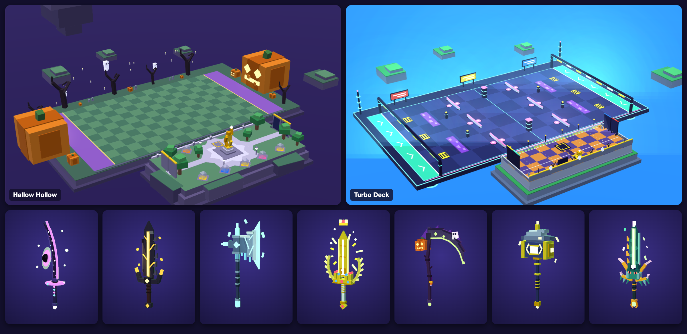
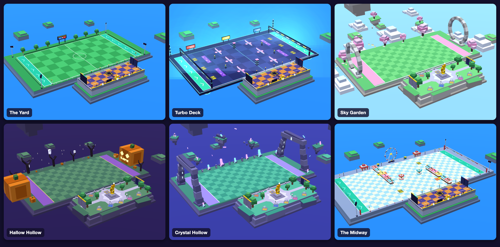
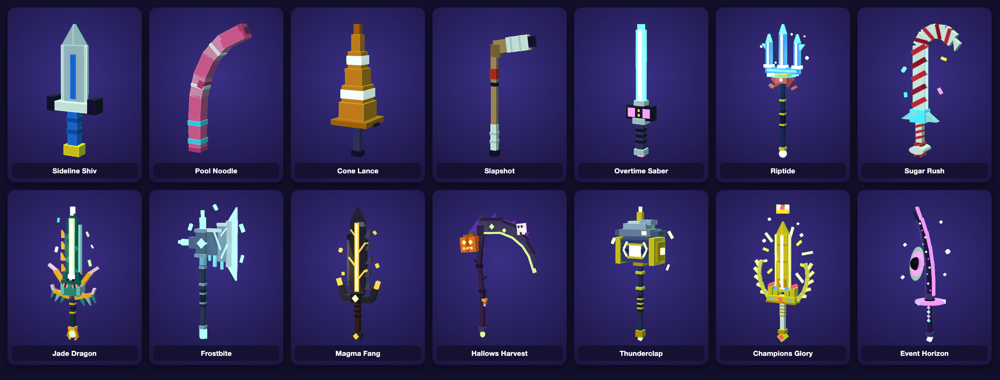
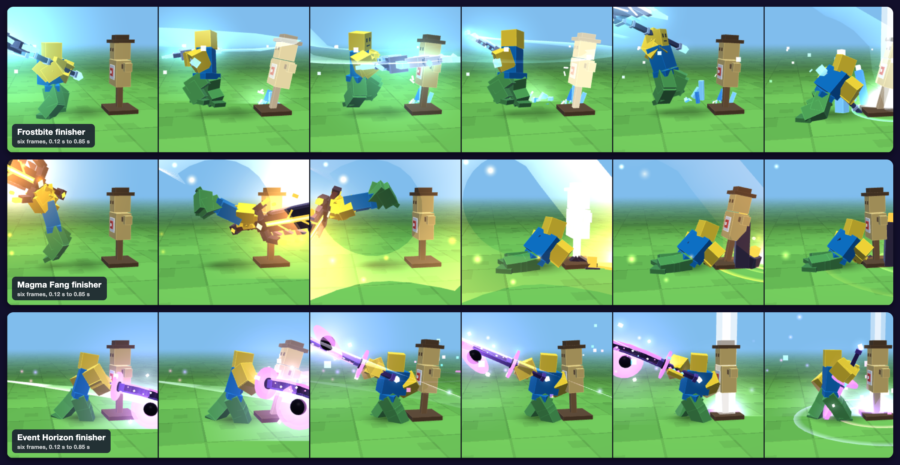
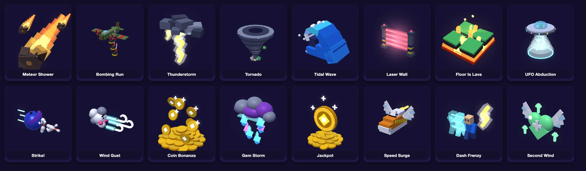
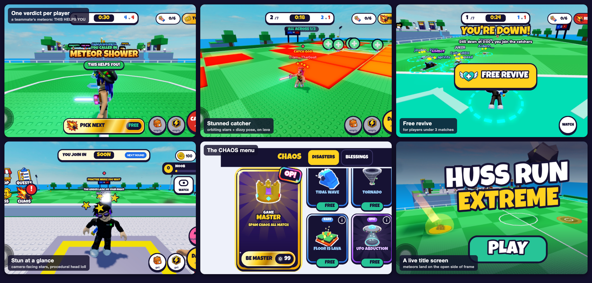
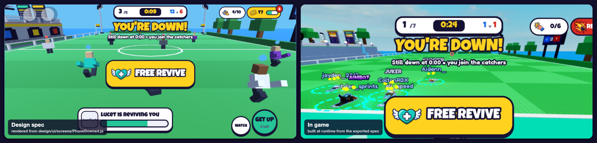
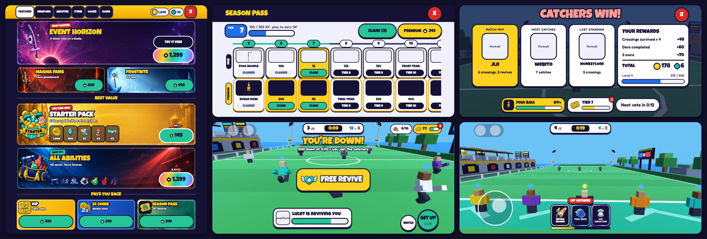
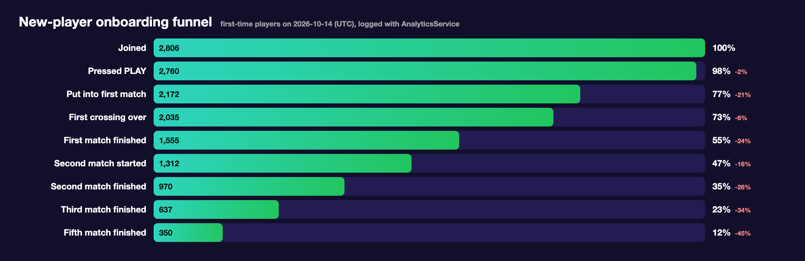

# Huss Run Extreme

**A live, phone-first multiplayer Roblox game, built solo and launched two days after the first commit, with lag-compensated combat, a data-driven content pipeline, and analytics built in from launch day.**

[**▶ Play on Roblox**](https://www.roblox.com/games/71842565259467) · 33,500+ visits · 940+ favorites · 24-player servers · launched October 2026



> This is a showcase. The game's source is private; what follows describes how it is built. Every map, weapon and effect pictured here was authored as data and rendered by the game's own pipeline, with no 3D artist.

---

## The game in one paragraph

Huss Run Extreme is sharks-and-minnows for 24 players. Runners cross a field; catchers try to tag them; anyone tagged switches sides. Each crossing can bring **CHAOS**: meteor showers, bombing runs, tidal waves, UFO abductions, or coin storms that reward the brave. Players can call events in on the other team, or become the **Game Master** and direct the chaos for a whole match. Around that core: a hero mechanic (one player crosses alone while everyone watches), 19 weapons with animated finishers, 8 maps, capture the flag, a season pass, quests, and a full in-game store. **92% of players are on phones**, so every screen is designed for a thumb first.

---

## The world

Eight maps, each with its own theme and set dressing: a stadium pitch, a neon deck, a cherry-blossom sky island, a haunted pumpkin patch and more.



Nineteen weapons, from a starter shiv and a pool noodle up to premium blades with their own effects:



Each premium weapon ends a match with its own animated finisher:



Sixteen CHAOS events, each built around one hero prop:



And in a match:



---

## What makes it interesting to build

| | |
|---|---|
| **Multiplayer correctness** | Server-authoritative match state; client-predicted tags confirmed by a server rewind over position history; ties go to the runner. |
| **Content at scale without an artist** | Maps, weapons, props, finishers and 68 UI screens are authored as data, previewed in WebGL, rendered headlessly and exported to Luau. About 75,000 lines of game content are generated, not hand-placed. |
| **A pure, tested core** | Every rule that decides an outcome lives in side-effect-free modules with 471 offline tests that run in seconds. |
| **Measured from day one** | Six analytics funnels, day-1/3/7 cohort retention, and a same-day telemetry store, because the platform's own charts arrive a day late. |
| **Shipping cadence** | First commit Oct 5, live Oct 7; then near-daily updates (movement rework, abilities, the CHAOS update) informed by the funnel data. |

---

## Architecture

```
src/
  ReplicatedStorage/Shared/
    Config/     tuning only: numbers a designer changes (movement, combat, chaos odds, prices)
    Logic/      pure rules: match state machine, catch proof, chaos planning, poses, economy
    Build/      builders that turn exported design data into instances (also run offline)
    Util/       Net (typed, rate-limited remotes), Loader, seeded RNG, clocks
  ServerScriptService/Server/Services/   29 services: match, catch, chaos, data, store, analytics…
  StarterPlayerScripts/Client/           30 controllers + UI built from exported screen specs
design/                                  the content pipeline (JavaScript, WebGL, headless Chrome)
tests/specs/                             42 spec files, 471 tests, run under Lune with no Studio
tools/                                   build, test, audit, analytics, audio and asset scripts
```

**Toolchain:** Rojo · Wally · Lune · Selene · StyLua · luau-lsp, pinned with Rokit. **Codebase:** about 42,000 hand-written lines of Luau across 177 modules, plus 75,000 generated.

**Layering rule:** `Logic/` never touches the engine. A match is a state machine (`MatchState`) that takes events and returns events; services apply them and replicate state as attributes, so late joiners and spectators are always correct. The same pure modules run on the server, on the client, and in the offline test harness.

---

## Netcode: tags that feel instant and stay fair

Tagging is the whole game, so it has to feel immediate on a phone with 150 ms of ping and still be impossible to fake.

1. **The catcher's client decides it hit**, against what it sees, and sends a claim. The swing feels instant.
2. **The server proves it.** It keeps a one-second position history per player (sampled every frame) and rewinds both players by the catcher's ping plus a margin, capped at 300 ms:

   ```lua
   -- attacker, target: position histories. now: server time. ping: the catcher's, in seconds.
   function CatchRules.proven(attacker, target, now, ping, cfg)
   	local back = CatchRules.rewind(ping, cfg)
   	local distance, height = CatchRules.closest(attacker, target, now - back, now, 6)
   	local limit = cfg.Reach + cfg.HitRadius + cfg.ClaimTolerance
   	return distance <= limit and height <= cfg.VerticalReach, distance
   end
   ```

3. **Ties go to the runner.** A runner reaching the safe line reports it with a timestamp; a catch right at the line waits a short grace window for that report.
4. **Everything else is server-side:** swing cooldowns, a speed envelope from the same history (rubber-banding on violations), field bounds, every payout. All remotes go through a `Net` layer with typed validators and per-player rate limits, and a static audit fails the build if any of the 73 remotes is used without a definition.
5. **Measured, not guessed:** the hit window was tuned in Studio with scripted dummies at fixed distances (0.5 to 13 studs ahead, behind, to the side), and the results are recorded in the design doc next to the numbers they justify.

---

## The content pipeline: data → preview → render → game

The game has no 3D artist. Every map, weapon, prop, effect and screen is authored as **data**, which gives one source of truth for three outputs:

```
 design/project/*.js  ──►  WebGL preview (live, interactive)      review on a canvas
        │            ──►  headless Chrome renders (PNG)          thumbnails, store art, QA sheets
        └─ export.js ──►  Shared/Config/Designs/*.luau            generic Build/* modules make the instances
```

- **Maps:** a map format of floor slabs, painted lines, props by reference, pads, spawn lines and flag rings. Each map renders from fixed camera rigs (lobby corner, far corner, player point of view, top-down) so layout changes can be reviewed side by side before they reach Studio.

- **Weapons and finishers:** each weapon is parts plus an effect spec. A small solver poses the rig for each swing keyframe, and the **same** keyframes drive the in-game animator, so the web preview and the game cannot drift apart. The finisher strips above are generated automatically for every weapon.

- **CHAOS events:** each event's "hero" prop (the meteor, the bomber, the UFO) is modelled once and reused three ways: as the in-world effect, as the card art in the store, and as the icon. Icons are keyed out with an outline by a script, then uploaded through Roblox Open Cloud.

- **Asset delivery:** `upload.py` pushes images and audio to the game's group through the Open Cloud Assets API, polls the operation until the asset exists, and writes the returned ids straight into the config modules, so an asset is never referenced by a hand-typed id.

---

## UI as a spec, not as hand-placed frames

All 68 screens (phone and PC variants) are written as **Roblox-native specs**: anchor points, UDim2 sizes, UICorner, UIStroke, gradients, and named nodes. One spec feeds two renderers:

- an **HTML renderer** that draws it pixel-for-pixel for review, so a whole screen can be iterated on in seconds outside Studio;
- an **exporter plus a runtime builder (`BuildUi`)** that turns it into real instances in game. Controllers only find nodes by name and bind behaviour; they never lay anything out.





Every UI change is checked by rendering the spec, then capturing the live screen in a Studio playtest at phone resolution, before it ships.

---

## CHAOS: a deterministic event system

- **Planned once, drawn everywhere.** An event is a pure plan (`ChaosRules.plan`) built from a seeded RNG: hit zones and timings, pickups, and whole-field modifiers. The server sends each plan once and judges hits from it on a 20 Hz tick; every client animates the same plan locally. Only the plan and the outcomes cross the network, never per-frame positions of meteors, waves or planes.
- **Waves.** A crossing's events start together and repeat as fresh waves until the run ends, with new spots and lanes each time.
- **One message per player.** All of a crossing's disasters must point the same way (everyone, or one side), so each player gets one clear verdict: **WATCH OUT!** or **THIS HELPS YOU!** Calls that would break the rule wait in a queue and keep their place.
- **Fairness rules, enforced in pure code and tested:** at most two called events per crossing, the biggest event reserved for the Game Master, refunds for queued calls if the caller leaves, no paid randomness, and a daily free call that is never sold.
- **Readable feedback.** Stunned players get orbiting stars and a procedural dizzy pose layered on top of the run cycle; impact zones are drawn red when they can hit you and blue when they can't.

---

## Procedural animation

Characters move with a hand-built sprint cycle, leans, banks into turns, crossover steps on hard cuts, dash and dive poses, foot planting so shoes never sink into the floor, and a downed collapse. All of it is computed on each client from observed velocities, so every player sees it for every other player at no network cost. The pose math lives in nine pure modules (`SprintCycle`, `TurnPose`, `CutPose`, `DodgePose`, `SwingPose`, `FallPose`, `StrafePose`, `ArmPose`, `AthleticPose`), each with its own specs, and the feel numbers sit in one tuning file. The movement itself was rebuilt from a frame-by-frame study of a reference recording, written up in the project docs.

---

## Analytics and live operations

The game logs to Roblox's AnalyticsService **and** to its own daily tally in a DataStore, flushed once a minute by every server, because the platform's charts lag by a day and launch decisions can't.

**Six funnels**

| Funnel | Steps | Question it answers |
|---|---|---|
| Onboarding | Joined → PLAY → first match → first crossing → … → fifth match | How far does a brand-new player get? |
| Session | Joined → … → 1, 2, 3, 5, 8 matches | How deep does one sitting go? |
| Match | Put in → crossings 1, 3, 5 → finished → next match | Do people quit mid-match or between matches? |
| Chaos | Chaos hit the field → crossing over → match finished → next match | Does chaos make people leave? |
| Chaos Call | Opened CHAOS → tapped an event → call placed → saw it go off | Where does the call flow lose people? |
| Game Master | Saw it → pressed → got a turn → became GM → summoned 3 → finished | Does the premium mode deliver? |



**Beyond funnels:**

- **Leave records:** what the player was doing, after how long, on which map and device.
- **Cohorts:** for 50+ early behaviours (started as a runner or a catcher, first crossing made or failed, waited 20 s+ for a match, used the free revive, was hit by an event), the share of that day's new players who returned on days 1, 3 and 7, set against those who didn't. The tool flags which rows are honest signals (early, not chosen by the player) and which are just correlated with playing longer.
- **Per-event churn:** players who walked out during a crossing with each event, against the base rate for plain crossings.
- **Studio dry-run recorder:** in a test session, every funnel step and event a live server *would* send is recorded, so instrumentation is verified before it ships.

The CHAOS funnels were added to answer one question about the biggest update so far: does it help? Each event is compared with plain crossings, and each new behaviour (calling an event, being hit by one, playing as Game Master) with next-day return.

---

## Audio

About 100 cues. Original effects are generated with ElevenLabs in batches of several takes, laid out on comparison pages for picking by ear, trimmed, then uploaded through Open Cloud with ids written back into config. World sounds use per-cue roll-off, so a meteor landing across the field is heard from the right direction.

---

## Quality gates

`tools/scripts/run-tests.sh --lint` runs on every change:

- **471 Lune tests** over the pure core: match state, catch proof, chaos planning, economy, data migrations, receipts, poses, analytics rules;
- a **require audit** (every `require` resolves) and a **remote audit** (every remote used is defined, with its validator);
- **Selene** lint and **StyLua** formatting;
- a **docs index test** that fails when a doc goes missing from the index.

Robux purchases go through an idempotent receipt handler that writes the grant and the receipt into the same save and acknowledges only after the save is confirmed.

---

## How it was built

A solo project. I designed the game, made every product and UX call, playtested on real phones, and read the analytics daily. The engineering was done with **AI coding agents (Anthropic's Claude Code, plus OpenAI's Codex for parts of the movement work)** working under my direction: a written plan, small reviewed steps, a test suite, and visual checks in Studio before anything shipped. The pipelines above exist largely to make that collaboration safe: pure, testable rules; data that renders the same everywhere; and audits that catch a broken require or an undefined remote before a player ever could.

---

*All rights reserved. This repository is for review only; the game, its art and its code are not licensed for reuse.*
